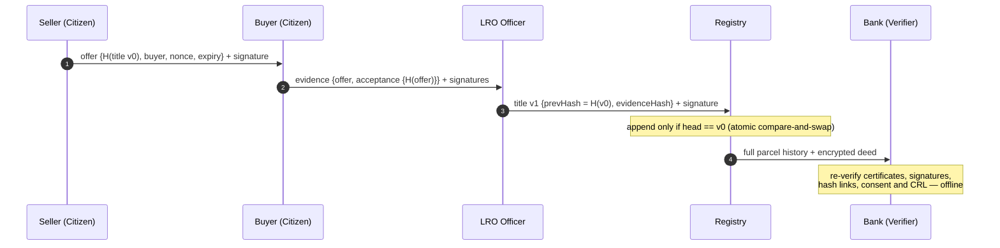
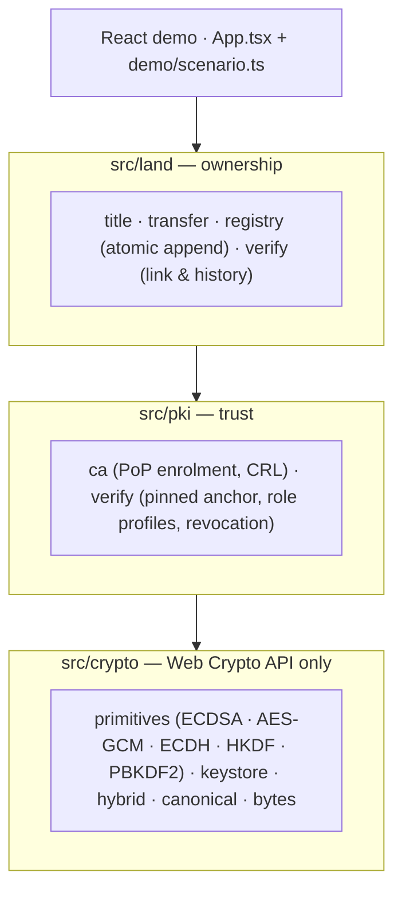

<div align="center">

# 🏞️ BhūmiSign

**Browser-only PKI for land titles — every key, signature and check runs in your browser.**

[](https://github.com/anmol-chhetri-G/Bhumisign/actions/workflows/ci.yml)


*ST6051CEM Practical Cryptography · Individual coursework*

[Overview](#overview) · [Architecture](#architecture) · [Security model](#security-model) · [Quick start](#quick-start) · [Verification](#verification) · [Limitations](#known-limitations)

</div>

---

## 📖 Overview

BhūmiSign is a Public Key Infrastructure for land-title registration and transfer that runs **entirely client-side** on the native **Web Crypto API** — no backend, no third-party crypto library, no server-side key storage.

It targets the fraud patterns documented in Nepal's land system (double sale, forged deeds, insider manipulation of records): ownership changes only with **cryptographically proven consent from both parties**, every record is **hash-linked and independently re-verifiable**, and revocation **fails closed**.

## 🏗️ Architecture

### Actors

| Actor | Certificate role | Keys | Responsibility |
| :--- | :--- | :--- | :--- |
| **LRO / CA** | `ROOT_CA` | ECDSA P-256 (`certSign`, `crlSign`) | Certifies actors, publishes the CRL |
| **LRO Officer** | `LRO_OFFICER` | ECDSA (`titleSign`) + ECDH | Issues first titles, executes transfers |
| **Citizen** | `CITIZEN` | ECDSA (`transferSign`) + ECDH | Signs sale offers and acceptances |
| **Verifier / Bank** | `VERIFIER` | ECDH (`dataEncrypt`) | Re-verifies parcel history, receives encrypted deeds |

### The transfer protocol



### Layering



**Phases:** ① Set-up & enrolment (root CA, proof-of-possession, CRL) → ② Issuance (seq 0) → ③ Transfer (offer → acceptance → atomic append) → ④ Third-party verification.

## 🛡️ Security model

Core invariants, each enforced in code *and* asserted by a named test:

- **Pinned trust anchor** — the root certificate comes from out-of-band pinning and is self-checked; a substituted anchor is rejected.
- **Domain-separated signatures** — every signature covers `BhumiSign/v1/<context>\n<canonical JSON>`, so a title signature can never be replayed as a certificate signature.
- **Hashes cover bodies, never signatures** — ECDSA signatures are malleable; identity is defined by canonical bodies only.
- **Consent is non-repudiable** — the seller's offer is bound to the hash of one exact title version; the buyer countersigns the offer hash; both are stored and re-verified.
- **As-of-issuance revocation semantics** — certificates are evaluated at the registry-attested issuance time, never a signer-claimed time (a back-dated offer cannot dodge a revocation).
- **Fail-closed revocation** — missing, stale, forged or edited CRLs are errors, not passes.
- **Atomic append** — compare-and-swap with no `await` between check and write; concurrent double sales cannot both succeed.

<details>
<summary><b>Full threat → defence → code → test traceability table</b></summary>

| Threat | Defence | Code | Test evidence |
| :--- | :--- | :--- | :--- |
| Forged / edited certificate | ECDSA over canonical JSON, pinned root | `pki/verify.ts` | `pki.test.ts` tampered-field block |
| Substituted trust anchor | Anchor pinned + self-checked | `verifyCertificate` | `pki.test.ts` substituted-anchor test |
| Registering someone else's key | Proof of possession at enrolment | `pki/ca.ts` | `pki.test.ts` BAD_POP tests |
| Role escalation | `ROLE_PROFILE` at issuance and verification | `pki/types.ts`, `verify.ts` | `pki.test.ts`, `land.test.ts` |
| Compromised / retired key | Signed CRL, fail closed | `verifyCrl` | `pki.test.ts` revocation block |
| Cross-purpose signature replay | Context prefix in signing input | `primitives.ts` | `primitives.test.ts` |
| Double sale / concurrent sales | Title-hash binding + atomic CAS | `transfer.ts`, `registry.ts` | `land.test.ts` double-sale tests |
| Replay of executed consent | Single-use nonce + expiry | `registry.ts` | `land.test.ts` replay / nonce tests |
| Selling land you do not own | Seller must equal current owner | `verifyLink` | `land.test.ts` NOT_OWNER tests |
| Buyer never agreed | Countersignature over offer hash | `transfer.ts` | `land.test.ts` acceptance tests |
| Malicious officer (valid sigs, wrong links) | Evidence + hash chain re-verified | `land/verify.ts` | `land.test.ts` "malicious officer" block |
| Back-dating past revocation | Registry-attested time, ±5 min skew | `registry.ts`, `verify.ts` | `land.test.ts` clock-skew tests |
| Tampered history | Hash chain + third-party re-verification | `verifyHistory` | `land.test.ts` mutation-of-history block |
| Stolen deed | ECDH-ES + HKDF + AES-256-GCM | `hybrid.ts` | `keystore-hybrid.test.ts`, scenario |
| Stolen key blob | PBKDF2 600k + AES-GCM wrap, AAD binds kind/label | `keystore.ts` | `keystore-hybrid.test.ts` |
| Invalid-curve attack | `importKey` validates the point | `primitives.ts` | `keystore-hybrid.test.ts` |
| Crash on hostile input | Strict validators; result types, never throws | `validate.ts`, `result.ts` | `land.test.ts`, `primitives.test.ts` |

</details>

<details>
<summary><b>Design decisions and their rationale</b></summary>

| Decision | Why |
| :--- | :--- |
| Custom signed-JSON certificates, not X.509 | Web Crypto cannot parse X.509; an ASN.1 library would hide the crypto being assessed |
| ECDSA P-256 + SHA-256 | Universal Web Crypto support; 64-byte signatures |
| Canonical JSON before hashing/signing | Signatures must not depend on whitespace or key order |
| Separate signing and encryption keys | Compromise of one capability does not grant the other |
| PBKDF2-HMAC-SHA-256, 600 000 iterations | OWASP guidance; Web Crypto has no Argon2 |
| Fresh random 96-bit IV per AES-GCM message | Far below the ~2³² messages-per-key safety limit |
| Leaf validity capped at CA expiry | No certificate outlives its issuer |

</details>

## 🚀 Quick start

**Prerequisites:** Node.js ≥ 22.12 · Python 3 + OpenSSL (optional, for independent cross-checks)

```bash
git clone https://github.com/anmol-chhetri-G/Bhumisign.git
cd Bhumisign

npm ci               # exact pinned versions from package-lock.json
npm run typecheck    # strict TypeScript, zero errors
npm test             # 108 passing, 1 optional export skipped
npm run coverage     # thresholds enforced in vite.config.ts
npm run build        # type-check + production bundle
npm run dev          # http://localhost:5173 → click "Run full scenario"
```

> [!IMPORTANT]
> Web Crypto only exists in a **secure context**. `localhost` works; a plain `http://` LAN address does not.

## 🖥️ Browser demo

`npm run dev`, then **Run full scenario**: 12 rows — the honest flow accepted, every attack rejected with its exact error code (`HEAD_MISMATCH`, `NOT_OWNER`, `REVOKED`, `USAGE_NOT_PERMITTED`, …). No row red, no console errors, no cross-origin network requests.

<!-- Uncomment after adding a screenshot:
<p align="center"></p>
-->

## 🧪 Verification

| Command | What it proves |
| :--- | :--- |
| `npm run typecheck` | Type-correct under `strict` + `noUncheckedIndexedAccess` |
| `npm test` | 108 behaviours hold, including every attack in the scenario |
| `npm run coverage` | 99.2% lines · 94.7% statements · 90.6% branches · 100% functions |
| `python3 scripts/mutate.py` | The suite notices broken code: 25/26 mutants caught, 1 equivalent |
| `python3 scripts/verify_with_openssl.py …` | An implementation I did not write accepts my signatures |

**Independent cross-checks** — known-answer tests (FIPS 180-4 SHA-256, RFC 5869 HKDF, published PBKDF2 vector), two-way interop with Node `crypto`, and OpenSSL:

```bash
env DUMP=1 npx vitest run tests/scenario.test.ts   # writes out/sample-*.json
python3 scripts/verify_with_openssl.py out/sample-root.json out/sample-certificate.json
# root self-signature : True
# certificate         : True
# tampered certificate: False (expected False)
```

<details>
<summary><b>Mutation testing: 26 deliberate bugs, 25 caught</b></summary>

Each mutant is applied to a temporary copy; the working tree is never touched.

| # | Deliberate bug | Caught by |
| :--- | :--- | :--- |
| M1 | Skip CRL revocation check | revoked-parties transfer test |
| M2 | Drop signature domain separation | context-replay test |
| M3 | Remove registry compare-and-swap | concurrent double-sale test |
| M4 | Skip proof of possession | BAD_POP enrolment test |
| M5 | Constant AES-GCM IV | fresh-IV test |
| M6 | Skip prevHash link check | malicious-officer splice test |
| M7 | Key-wrap AAD ignores label | blob-tampering test |
| M8 | Trust signer-claimed time | back-dated revocation test |
| M9 | Accept expired CRL | fail-closed CRL test |
| M10 | Ignore key usage | non-officer title test |
| M11–M17 | Skip chain / consent consistency checks | malicious-officer block |
| M18 | Never record used nonces | nonce-reuse test |
| M19 | Skip clock-skew check | back/future-dated title test |
| M20 | Drop PBKDF2 iteration floor | key-blob policy test |
| M21 | Unsorted canonical JSON | key-order independence test |
| M22 | No leaf-validity cap | CA-expiry cap test |
| M23 | Extractable unwrapped keys | non-extractability test |
| M24 | Drop DUPLICATE_PARCEL guard | duplicate-registration test |
| M25 | Hybrid KDF ignores public keys | documented-construction test |
| M26 | Skip CRL issuer field | *equivalent mutant* — only the CA key could forge such a CRL; defence in depth |

Mutation testing found real test gaps (signature checks masking link checks), closed by the "malicious officer" block; a failing revocation test found a real bug (signer-claimed time), fixed by as-of-issuance semantics.

</details>

## 📂 Project structure

```text
Bhumisign/
├── .github/workflows/ci.yml   # typecheck → coverage → build on every push
├── src/
│   ├── crypto/                # bytes · canonical · primitives · keystore · hybrid
│   ├── pki/                   # types · validate · verify · ca
│   ├── land/                  # types · title · transfer · verify · registry · validate
│   ├── demo/scenario.ts       # 12-step end-to-end story (honest flow + attacks)
│   ├── App.tsx · main.tsx     # thin React UI — the marks are in the crypto
│   └── result.ts              # shared error vocabulary (no throwing verifiers)
├── tests/                     # 6 test suites (108 tests + 1 optional export) + helpers.ts
├── scripts/                   # mutate.py · verify_with_openssl.py
└── vite.config.ts             # coverage thresholds enforced
```

## ⚠️ Known limitations

- **Not X.509** — custom signed-JSON profile; real-PKI interoperability is out of scope.
- **One root, no hierarchy** — a production root lives offline in an HSM; here it is a non-extractable browser key.
- **Identity proofing simulated** — `subject.id` stands in for a verified citizenship record.
- **In-memory registry** — no persistence/replication; a trusted operator can withhold records but cannot forge consent.
- **Trusted clock** — a compromised officer key can back-date by ≤ 5 min at append; RFC 3161 timestamps are the production fix.
- **Revocation latency** — a certificate stays acceptable until the verifier holds a CRL listing it (24 h in the demo); tested and documented.
- **PBKDF2, not Argon2** — Web Crypto offers no Argon2.
- **Browser limits** — JS cannot guarantee constant-time execution or memory zeroisation.

---

<div align="center">

*Individual submission · ST6051CEM Practical Cryptography*  
**Anmol Chhetri** · [@anmol-chhetri-G](https://github.com/anmol-chhetri-G)

</div>
